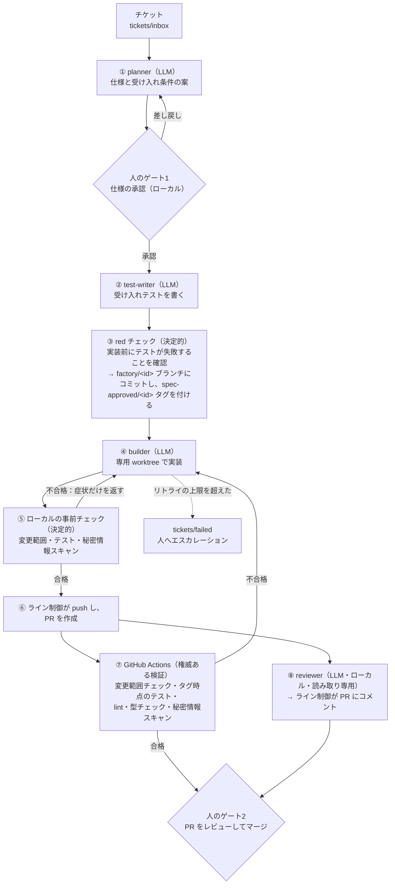

# ソフトウェアファクトリー 新規構築 設計案（v0.2）

- 作成日: 2026-11-24
- 状態: 検討用ドラフト（まだ何も構築していない）
- 前提となる調査: `software-factory-research.md`
- v0.2 での変更: GitHub の **public リポジトリ**を使う前提にした。人のゲート2を PR に、権威ある検証を GitHub Actions に移した。公開リポジトリの運用ルール（§7）を追加した。

---

## 1. 基本方針

1. **既存の部品は使わない**
   ユーザーレベルのスキル、エージェント、プラグイン、フックは使わず、工場に必要なものはすべてこのリポジトリの中に新しく作る。
2. **エンジンは Claude Code**
   WSL 内の Claude Code を使う。工場は「Claude Code を部品として呼び出す生産ライン」として作る。
3. **1工程 = 1つの独立した `claude -p` プロセス**
   役割ごとに、使えるツール・権限・予算・プロンプトを分ける。
4. **検証は、作る側の手が届かない所で行う**
   最終的な合否は、GitHub Actions のまっさらな環境で判定する。
5. **固定したグラフの中に、LLM の工程を置く**
   工程の順番と合否の判定ロジックは決定的なスクリプトで書き、LLM には各工程の中身だけを任せる。
6. **公開を前提にする**
   リポジトリはいつ public にしても困らない状態を保つ。機密情報は載せないことを、ルールだけでなく仕組みで担保する（§7）。
7. **LLM には外部への書き込み権限を渡さない**
   push、PR の作成、コメントの投稿は、ライン制御のスクリプトだけが行う。
8. **小さく始める**
   最初は手動で起動するライン1本だけを作り、起動のきっかけや自動化の範囲は後から増やす。

---

## 2. 実行環境（確認済み）

| 項目          | 状態                                                                                  |
| ------------- | ------------------------------------------------------------------------------------- |
| OS            | Ubuntu 24.04.1 LTS（WSL2）。systemd は PID 1 で動作中                                 |
| Claude Code   | 2.1.312                                                                               |
| git / gh      | あり。gh はログイン済み。git のグローバルな作者情報（user.name / user.email）は未設定 |
| Node.js / npm | v24.11.1                                                                              |
| Python        | 3.12.3（uv はなし）                                                                   |
| その他        | jq、docker、crontab（cron サービスは有効）、tmux                                      |

**注意**

- WSL 側の `~/.claude` にも、ユーザーレベルの設定、スキル、フック、プラグインがすでにある。工場を実行するときは、これらを読み込まないように分離する（§8）。
- 同じユーザーで動く LLM の工程は、Bash から gh や Claude の認証情報ファイルを読めてしまう。公開リポジトリでは、これが最も危険な漏えいの経路になる（§6、§7）。

---

## 3. 全体の流れ



---

## 4. リポジトリ構成案

```
software-factory-trial/
├── README.md
├── LICENSE
├── SECURITY.md                  # 脆弱性の報告窓口
├── .gitignore                   # runs/、.env*、鍵ファイル、ローカル設定などを除外する
├── .github/
│   └── workflows/ci.yml         # 権威ある検証（秘密情報を一切使わない）
├── docs/
│   ├── factory-design.md        # この設計書
│   ├── software-factory-research.md
│   └── adr/                     # 設計判断の記録
├── factory/                     # 工場本体（ライン）
│   ├── bin/factory              # 入口の CLI（run / approve / status / stop）
│   ├── line/                    # ライン制御（工程グラフの実行、push、PR 作成）
│   ├── roles/                   # 役割ごとの定義（prompt.md、settings.json、schema.json）
│   │   ├── planner/  test-writer/  builder/  judge/  reviewer/
│   ├── checks/                  # 決定的な検証（変更範囲、テスト実行、秘密情報スキャン、シナリオ実行）
│   ├── hooks/                   # ガードレール用のフックスクリプト
│   └── config.toml              # モデル、予算上限、リトライ上限（秘密情報は書かない）
├── product/                     # 題材のプロダクト（工場が作るもの）
│   ├── CLAUDE.md
│   ├── src/
│   └── tests/
│       ├── unit/
│       └── acceptance/          # test-writer だけが書く
├── tickets/                     # 作業キュー（公開される。機密情報は書かない）
│   ├── inbox/  doing/  done/  failed/
├── specs/                       # 承認済みの仕様
└── runs/                        # 実行ログ（git の管理外。絶対パスやプロンプトを含むため）
```

**リポジトリの外に置くもの**

- ホールドアウトのシナリオ：公開すると採点基準が丸見えになるので、ローカルの別ディレクトリに置く
- 認証情報：gh のトークン、Claude の認証情報、API キー
- 実行ログの生データ

---

## 5. 工程（ステーション）の設計

| #   | 工程                             | 種類        | 実行場所                           | 出力                                                                           | 使えるツール                                        |
| --- | -------------------------------- | ----------- | ---------------------------------- | ------------------------------------------------------------------------------ | --------------------------------------------------- |
| ①   | planner                          | LLM         | ローカル                           | 仕様の案（`--json-schema` で構造化し、ファイルへの書き出しはライン制御が行う） | Read, Grep, Glob                                    |
| G1  | 人のゲート1                      | 人          | ローカル                           | `factory approve <id>` で承認                                                  | －                                                  |
| ②   | test-writer                      | LLM         | ローカル                           | `product/tests/acceptance/` 以下のテスト                                       | Read, Grep, Glob, Write, Edit, Bash（テスト実行用） |
| ③   | red チェック                     | 決定的      | ローカル                           | 実装前にテストが失敗することを確認し、コミットしてタグを付ける                 | －                                                  |
| ④   | builder                          | LLM         | ローカル（Phase 4 からはコンテナ） | `product/src/` 以下の実装                                                      | Read, Grep, Glob, Write, Edit, Bash                 |
| ⑤   | ローカルの事前チェック           | 決定的      | ローカル                           | 合否と症状（リトライを速く回すためのもの）                                     | －                                                  |
| ⑥   | push と PR の作成                | 決定的      | ローカル                           | `factory/<id>` ブランチと PR。PR の本文はテンプレートから生成し、無害化する    | －                                                  |
| ⑦   | CI                               | 決定的      | GitHub Actions                     | 権威ある合否                                                                   | －                                                  |
| ⑧   | reviewer                         | LLM         | ローカル                           | `{verdict, findings[]}`。ライン制御が PR にコメントとして投稿する              | Read, Grep, Glob（`--restricted`）                  |
| ⑨   | シナリオ実行＋judge（Phase 4〜） | 決定的＋LLM | ローカル                           | スコアだけを PR にコメントする（シナリオの中身は出さない）                     | judge は `--restricted` ＋ Read だけ                |
| G2  | 人のゲート2                      | 人          | GitHub                             | PR をレビューしてマージする                                                    | －                                                  |

### ⑦ CI（権威ある検証）の中身

1. **変更範囲チェック**
   `spec-approved/<id>` タグから PR の先頭までの差分が、`product/src/**` だけに収まっているかを確認する。テスト、工場、ワークフロー、設定ファイルに変更があれば不合格にする。
2. **タグ時点のテストで検証**
   テストはタグの時点のものを取り出して実行する。lint、型チェック、単体テスト、受け入れテストを行う。
3. **秘密情報スキャン**
   ローカルと同じルールで、差分全体を確認する。
4. **秘密情報を一切使わない**
   CI には API キーなどを置かない。LLM を使う工程（reviewer、judge）はローカルで実行し、結果だけを PR に書き込む。

### main ブランチの保護

- main への直接の push を禁止し、PR と CI の合格を必須にする
- 「承認レビューを必須」にはしない。ライン制御は人と同じ gh アカウントで PR を作るため、GitHub の仕様上、自分の PR を自分で承認できず、マージできなくなってしまう。人のゲートは「人がマージボタンを押すこと」とする（工場専用のアカウントや GitHub App を用意すれば、承認を必須にできる。これは後の検討課題とする）

ライン制御のスクリプトでも、main を直接は変更できない。

---

## 6. ガードレール（多層防御）

| 層                              | 仕組み                                                                                                                                                                                                                  | 効果                                       | 限界・注意                                                                       |
| ------------------------------- | ----------------------------------------------------------------------------------------------------------------------------------------------------------------------------------------------------------------------- | ------------------------------------------ | -------------------------------------------------------------------------------- |
| 1. ツールの制限                 | 役割ごとに `--tools` で許可リストを指定し、`--permission-mode dontAsk --permission-prompts none` で動かす                                                                                                               | 想定外の操作を、最初からできないようにする | `--dangerously-skip-permissions` は使わない                                      |
| 2. パスの拒否ルール             | 役割ごとの settings.json に deny を書く                                                                                                                                                                                 | Bash を持たない役割には有効                | Bash を持つ役割は回避できる → 層4〜6で守る                                       |
| 3. フック                       | PreToolUse で次の操作を止める<br>・`git push`、`gh`、`curl`/`wget` などの外部送信<br>・認証情報の場所（`~/.config/gh`、`~/.claude`、`~/.ssh`、`.env*`）の読み取り<br>・破壊的なコマンド<br>PostToolUse で監査ログを取る | よくある事故と漏えいを防ぐ                 | Bash のすべてのパターンは防げない（ベストエフォート）                            |
| 4. LLM の工程から認証情報を外す | LLM の工程は、`GH_TOKEN` などを外した環境変数で起動する。push と PR 作成はライン制御だけが行う                                                                                                                          | LLM が外部に書き込めないようにする         | ファイルとして置かれている認証情報は、Phase 4 のコンテナ化まで読める可能性が残る |
| 5. 決定的チェック               | ローカルの事前チェックと CI（§5）                                                                                                                                                                                       | テストの改ざんや検証のごまかしを無効にする | **ここが本命**                                                                   |
| 6. 秘密情報スキャン             | コミット前・push 前・CI の3か所で行う。GitHub の push protection も併用する                                                                                                                                             | 公開リポジトリへの漏えいを止める           | 検出ルールにない形式は見逃す                                                     |
| 7. 物理的な分離                 | Phase 4 以降は、builder を Docker コンテナで動かす。worktree だけをマウントし、ネットワークも制限する                                                                                                                   | 認証情報とホールドアウトに到達できなくする | Phase 1〜3 の時点では、完全な隔離ではない                                        |
| 8. 予算と停止                   | 工程ごとに `--max-budget-usd` を付ける。リトライに上限を設ける。`factory stop` で止められる                                                                                                                             | コストの暴走を防ぐ                         | 上限を超えたときの挙動は要検証                                                   |
| 9. 人のゲート                   | 仕様の承認と、PR のマージ                                                                                                                                                                                               | 最終的な責任を人が持つ                     | －                                                                               |

---

## 7. 公開リポジトリの運用ルール

### 7.1 載せないもの

| 種類                     | 例                                                                   | 主な対策                                          |
| ------------------------ | -------------------------------------------------------------------- | ------------------------------------------------- |
| 認証情報                 | API キー、gh のトークン、パスワード、秘密鍵                          | フック、秘密情報スキャン、push protection         |
| 個人を特定できる情報     | 氏名、メールアドレス、ユーザー名を含む絶対パス（`/home/<user>/...`） | 作者情報を noreply にする、出力の無害化、スキャン |
| 組織の情報               | 会社名、顧客名、社内のシステム名・URL、社内の文書やデータ            | 題材とチケットは架空のものにする、スキャン        |
| 実行ログ                 | プロンプト、ツールの出力、コストの生データ                           | `runs/` を `.gitignore` に入れる                  |
| ホールドアウトのシナリオ | 採点用のシナリオ                                                     | リポジトリの外に置く                              |

### 7.2 仕組みで防ぐ

**ローカル**

- `.gitignore` で `runs/`、`.env*`、`*.pem`、`*.key`、`.claude/settings.local.json` などを除外する
- 自作の秘密情報スキャン（`factory/checks/secret_scan`）を、pre-commit と pre-push のフックで実行する
  - 検出するもの：トークンの形式、秘密鍵のヘッダー、メールアドレス、ホームディレクトリの絶対パス、禁止語リスト
  - 禁止語リスト（会社名など）は、それ自体が機密になりうるため、**リポジトリの外のローカルファイル**に置く
- ライン制御は、LLM が書いた文章（コミットメッセージ、PR の本文、コメント）を公開する前に無害化する（ホームディレクトリのパスを `~` に置き換える、メールアドレスを伏せる）
- コミットの作者情報は、このリポジトリだけ GitHub の noreply アドレスにする（グローバル設定は未設定なので、リポジトリ単位で設定する）
- コミットメッセージは1行の表題だけにし、トレーラーは付けない

**GitHub Actions**

- ローカルと同じ秘密情報スキャンを、CI でももう一度実行する
  - ただし、禁止語リストは CI では使わない。リストそのものを公開の場に置けないためで、禁止語の検査はローカルのフックが担当する
  - スキャンの結果には、ルール名と場所だけを出し、見つかった値は表示しない。公開リポジトリの CI ログは誰でも読めるため
- `permissions: contents: read` を基本にし、トークンの権限を最小にする
- `pull_request_target` は使わない
- 外部の人からのフォーク PR でワークフローを実行するときは、承認制にする
- 使用するアクションは、コミットの SHA で固定する

**GitHub の設定（ご自身で行うもの）**

- アカウントの設定で「Keep my email addresses private」と「Block command line pushes that expose my email」を有効にする
- リポジトリで secret scanning と push protection が有効になっていることを確認する
- main ブランチの保護ルールを設定する（§5）
- ライン制御用には、このリポジトリだけに権限を絞った fine-grained のトークンを発行する
  - Phase 1 では、既存の gh のログインで代用してもよい
  - トークンの発行と設定は、ご自身で行ってください（Claude はトークンの値を扱わない）

### 7.3 公開前のチェックリスト

1. 履歴全体に秘密情報スキャンをかけて、検出がゼロであること
2. すべてのコミットの作者が noreply アドレスであること
3. `runs/`、ホールドアウト、ローカル設定が、履歴に一度も含まれていないこと
4. README、LICENSE、SECURITY.md があること
5. ドキュメントに、個人の環境に固有の情報（絶対パス、ユーザー名、社内の事情）が残っていないこと

---

## 8. 設定の分離（既存の環境を読み込まない）

### 8.1 採用する方法（Phase 0 のプローブで確認済み）

工場の各工程は、次の組み合わせで起動する。

```bash
claude -p ... \
  --setting-sources project \
  --settings '{"claudeMdExcludes": ["<ホームディレクトリ>/.claude/CLAUDE.md"], "hooks": { ...役割ごとのフック... }}'
```

- `--setting-sources project`：ユーザーレベルの設定、スキル、プラグイン、MCP サーバー、フックを読み込まない
- `claudeMdExcludes`：ユーザーの CLAUDE.md を除外する
  - リポジトリがホームディレクトリの下にあるため、ユーザーの CLAUDE.md は祖先ディレクトリをたどる仕組みで「プロジェクトの指示」として読み込まれてしまう。`--setting-sources project` だけでは外れない
  - 除外するパスは、実行時にホームディレクトリから組み立てる（ユーザー名をリポジトリに書かないため）
- `--settings` で渡したフックは、この状態でも動く

### 8.2 プローブの結果（2026-11-24、`factory/probes/isolation-probe.sh`）

| 項目                         | 対照（分離なし）                                                     | 分離あり                                          |
| ---------------------------- | -------------------------------------------------------------------- | ------------------------------------------------- |
| ユーザーのスキル、プラグイン | 読み込まれる                                                         | 読み込まれない                                    |
| ユーザーの MCP サーバー      | 読み込まれる                                                         | 読み込まれない                                    |
| ユーザーレベルのフック       | SessionStart、UserPromptSubmit、PreToolUse、PostToolUse、Stop で動く | 動かない                                          |
| `--settings` で渡したフック  | 動く                                                                 | 動く                                              |
| ユーザーの CLAUDE.md         | 読み込まれる                                                         | 読み込まれない（`claudeMdExcludes` を付けた場合） |

### 8.3 分離されずに残るもの（意図どおり）

- **管理者が配布する設定（ある場合）**：管理者のポリシーとして適用されるもので、工場から外すべきものではない
- **Claude Code に組み込まれているスキルとエージェント**：一覧には表示されるが、役割ごとに `--tools` で Skill ツールや Agent ツールを渡さなければ使えない

### 8.4 採用しなかった方法

| 方法          | 理由                                                                                                                             |
| ------------- | -------------------------------------------------------------------------------------------------------------------------------- |
| `--bare`      | 認証が `ANTHROPIC_API_KEY` か apiKeyHelper に限られ、API の従量課金になる。また、`--settings` で渡したフックが動くかどうかが不明 |
| `--safe-mode` | 工場で使うフックまで止まる可能性がある                                                                                           |

API キーを使うことになった場合、キーの発行と設定はご自身で行ってください。キーは工場専用のものにし、利用額の上限を設定してください。

---

## 9. 観測（ログとコスト）

- 各工程は `--output-format json` で実行し、結果を `runs/<ticket>/<stage>.json` に保存する（公開しない）
- `runs/ledger.jsonl` に、1工程につき1行（チケット、工程、所要時間、コスト、結果）を追記する
- `factory status` で、進行中・失敗・完了の一覧と、累計コストを表示する
- 公開してよい集計値（件数、所要時間、合否）だけを、PR のコメントや週次のレポートに載せる
- 計測する指標
  - 着手からマージまでの時間
  - リトライの回数
  - 人が介入した回数
  - 1チケットあたりのコスト
  - 後からバグが見つかった割合

---

## 10. 起動のきっかけ（段階的に増やす）

| 段階    | 起動の方法                                             | 注意                                                                                                                                                                                                                                                                                         |
| ------- | ------------------------------------------------------ | -------------------------------------------------------------------------------------------------------------------------------------------------------------------------------------------------------------------------------------------------------------------------------------------- |
| Phase 1 | 手動：`factory run <ticket>`                           | －                                                                                                                                                                                                                                                                                           |
| Phase 3 | 夜間の定期実行：WSL の cron                            | PC が起動していて、WSL が動いている必要がある。Windows のタスクスケジューラから `wsl.exe -d Ubuntu -- ...` を呼ぶ方法を代わりの手段として用意する                                                                                                                                            |
| Phase 5 | GitHub Issues：gh で定期的に確認しに行く（ポーリング） | **public リポジトリでは誰でも Issue やコメントを書ける。** 次のすべてを満たすものだけを対象にする。<br>・トリガー用のラベルが付いている（ラベルを付けられるのは、権限を持つ人だけ）<br>・Issue の作成者が許可リストにいる<br>・LLM に渡すのは Issue の本文だけ（第三者のコメントは渡さない） |

---

## 11. 題材プロダクトの候補

工場の検証がしやすいように、**入力と出力が決定的で、自動で確かめやすいもの**を選ぶ。公開リポジトリなので、**業務とは関係のない架空の題材**にする。

| 候補       | 例                                                | 長所                                                             | 短所                         |
| ---------- | ------------------------------------------------- | ---------------------------------------------------------------- | ---------------------------- |
| CLI ツール | Markdown でタスクを管理する CLI、CSV の整形ツール | シナリオが「コマンドを実行して出力を比べる」だけで済み、最も簡単 | 見た目の要素がない           |
| Web API    | TODO や在庫管理の REST API                        | HTTP のシナリオでホールドアウト検証の練習になる                  | 起動や停止の管理が少し増える |

スタックは、TypeScript（Node 24）と Python 3.12 のどちらでも構築できる。

---

## 12. 構築フェーズと完了条件

| Phase                      | 内容                                                                                                                                                                                                                                                                                                                                                              | 目安   | 完了条件                                                                                                                                                                                                                                                                                                                                               |
| -------------------------- | ----------------------------------------------------------------------------------------------------------------------------------------------------------------------------------------------------------------------------------------------------------------------------------------------------------------------------------------------------------------- | ------ | ------------------------------------------------------------------------------------------------------------------------------------------------------------------------------------------------------------------------------------------------------------------------------------------------------------------------------------------------------ |
| 0 土台                     | ・git init、`.gitignore`、LICENSE、README、SECURITY.md<br>・秘密情報スキャンと、pre-commit / pre-push のフック<br>・リポジトリ単位の作者情報（noreply）<br>・題材の雛形と、チェックを1コマンドで実行できるようにする<br>・設定分離のプローブ実行<br>・§7.3 のチェックを通してから、GitHub に public リポジトリを作り、CI の骨組みと main ブランチの保護を設定する | 1日    | ・チェックのコマンドがすべて通る<br>・プローブ実行で、ユーザーレベルのスキルなどが見えないことを確認できる<br>・CI が緑になる<br>・§7.3 をすべて満たす                                                                                                                                                                                                 |
| 1 ライン v1                | ①〜⑧と、人のゲート1・2。手動で起動する                                                                                                                                                                                                                                                                                                                            | 2〜4日 | ・チケット3件が PR 経由でマージされる<br>・**改ざんのプローブ**：builder にテストを書き換えさせても、CI の変更範囲チェックで不合格になる<br>・**漏えいのプローブ**：builder にダミーのトークン文字列をコードへ書かせても、コミット前のスキャンで止まる<br>・LLM の工程から `git push` と `gh` が使えない<br>・全工程のコストが ledger に記録されている |
| 2 ガードレール強化         | フック、監査ログ、予算の上限、停止コマンド                                                                                                                                                                                                                                                                                                                        | 1〜2日 | 認証情報の場所の読み取り、外部への送信、破壊的なコマンドを試みるプローブが、すべて止められる                                                                                                                                                                                                                                                           |
| 3 夜間ループ               | 低リスクの定型タスクを1種類決め、毎晩1件ずつ PR を作る                                                                                                                                                                                                                                                                                                            | 1日    | 1週間無人で回り、毎朝 PR が揃っている                                                                                                                                                                                                                                                                                                                  |
| 4 ホールドアウト検証と隔離 | シナリオをリポジトリの外に置く、決定的な実行と restricted な judge、builder の Docker 隔離                                                                                                                                                                                                                                                                        | 3〜5日 | ・builder のコンテナから、ホールドアウトと認証情報が見えないことを、プローブで確認できる<br>・満足度のスコアが PR に記録される                                                                                                                                                                                                                         |
| 5 Issue 連携（任意）       | GitHub Issues のポーリング                                                                                                                                                                                                                                                                                                                                        | 2〜3日 | 許可された Issue だけが自動で処理され、第三者のコメントは LLM に渡らない                                                                                                                                                                                                                                                                               |

### 12.1 Phase 0 の結果（2026-11-24 完了）

| 完了条件                                                   | 結果                                                                                                     |
| ---------------------------------------------------------- | -------------------------------------------------------------------------------------------------------- |
| チェックのコマンドがすべて通る                             | `npm run check` が通った（型チェック、lint、テスト 23 件、秘密情報スキャン）                             |
| プローブで、ユーザーレベルの設定が見えないことを確認できる | 確認できた。ただし CLAUDE.md の除外には `claudeMdExcludes` が必要だった（§8）                            |
| CI が緑になる                                              | main への最初の push で、ジョブ `check` が成功した                                                       |
| §7.3 をすべて満たす                                        | 満たした（スキャンでの検出ゼロ、作者は noreply、`runs/` は未追跡、必須ファイルあり、個人情報の記載なし） |

**秘密情報スキャンの動作確認（使い捨てのリポジトリで実施）**

- 偽のトークン、禁止語、`.env` ファイルを含むコミットは、コミット前のフックで止まった
- noreply 以外の作者のコミットは、履歴の検査と push 前のフックで検出された
- どの出力にも、見つかった値そのものは含まれていなかった

**GitHub 側の設定（API で読み戻して確認済み）**

| 設定                              | 状態                                                                                                                                                    |
| --------------------------------- | ------------------------------------------------------------------------------------------------------------------------------------------------------- |
| main のルールセット               | 削除の禁止、強制 push の禁止、PR を必須にする（承認の必須数は 0）、ジョブ `check` の合格を必須にする（GitHub Actions に限定）。例外として通れる人はなし |
| Private vulnerability reporting   | 有効                                                                                                                                                    |
| 外部の人からのフォーク PR         | ワークフローの実行を承認制にした                                                                                                                        |
| secret scanning / push protection | 作成した時点で、どちらも有効になっていた                                                                                                                |

**Phase 1 で確かめること**

- ルールセットの `pull_request` ルールには、既定で `require_extra_approval_for_unattributed_changes: true` が付いた。承認の必須数を 0 にした状態で、工場が作る PR のマージに影響するかどうかを確かめる
- 禁止語リストはまだ空なので、組織に固有の語の検査は働いていない

---

## 13. 次に決めること

**決定済み（2026-11-24）**

- 題材：Markdown でタスクを管理する CLI「mdtask」
- スタック：TypeScript（Node.js 24）。工場本体と題材の両方で使う
- ライセンス：MIT
- リポジトリ名：software-factory-trial

**未決定**

1. **認証方式**：既存のログイン（サブスクリプション）を使うか、工場専用の API キーを使うか（§8）
2. **コストの上限**：1工程・1チケット・1日あたり

---

## 14. 要検証事項（CLI のヘルプやドキュメントで存在を知っているだけで、動作はまだ確かめていないもの）

- ~~`--setting-sources project` で、ユーザーレベルの設定・スキル・CLAUDE.md・プラグインが読み込まれなくなるか~~ → 確認済み（§8.2）。CLAUDE.md だけは `claudeMdExcludes` が必要
- `--bare` のときに、`--settings` で渡したフックが動くか（`--bare` は採用しないため、優先度は低い）
- ~~`--output-format json` の出力に含まれるコストのフィールド名~~ → `total_cost_usd` であることを確認済み。ターン数のフィールド名は未確認
- 自動メモリ（auto memory）を工程ごとに無効にする方法（プローブでは中身が空だったが、場所の説明はシステムプロンプトに入っている）
- `--restricted` と `--json-schema` を組み合わせたときの動き
- `--max-budget-usd` を超えたときの止まり方
- 環境変数を外して起動したときに、Claude Code 自身の認証が保たれるか
- PC のスリープ中や WSL の停止中に、cron がどう動くか
- ~~作成したリポジトリで、secret scanning と push protection が既定で有効になっているか~~ → 有効だった（§12.1）
