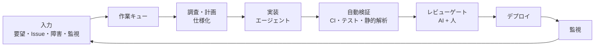
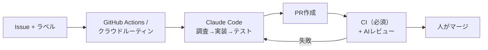
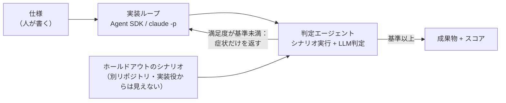

# ソフトウェアファクトリー 調査レポートと実践案

作成日: 2026-11-24

---

## 0. 先に結論

- **ソフトウェアファクトリー**とは、ソフトウェアを個人の腕前に頼って作るのではなく、**決まった工程・道具・検証の仕組みによって、品質のそろったソフトウェアを繰り返し生み出す**という考え方です。1960年代後半の日本の大手電機メーカーから始まり、2026年には「**AIエージェントが実装を担当し、人は意図（仕様）と検証の仕組みを設計する**」形で改めて注目されています。
- どの先行事例も同じ結論に至っています。**ボトルネックはコードを生成することではなく、検証すること**です。最も大事な設計原則は「**作る側のエージェントが、自分を採点する仕組みに手を出せないようにする**」ことです。
- 進め方としては、いきなり無人の工場（Dark factory）を目指すのはおすすめしません。まず Claude Code で「ミニ工場」を作り、**ループを1本ずつ増やしながら、詰まっている箇所（ボトルネック）を順に自動化していく**のが、先行事例に共通する進め方です。

---

## 1. ソフトウェアファクトリーとは何か：3つの世代

| 世代                                              | 時期                   | 代表例                                  | 中心となる考え方                                                                                                                                              |
| ------------------------------------------------- | ---------------------- | --------------------------------------- | ------------------------------------------------------------------------------------------------------------------------------------------------------------- |
| 第1世代：日本型ソフトウェア工場                   | 1960年代後半〜1980年代 | 日立・東芝・NEC・富士通                 | 工程の標準化、品質管理、コードの再利用。東芝は1980年代半ばに、納品するシステムのおよそ50%を再利用コードでまかなっていたと報告されている                       |
| 第2世代：Microsoft Software Factories             | 2004年頃               | Jack Greenfield、Keith Short            | DSL（ドメイン特化言語）、モデル駆動開発、ソフトウェアプロダクトラインを組み合わせ、開発ツールに手順とガイダンスを組み込んで、ライフサイクルの作業を自動化する |
| 派生：米国防総省の Software Factory               | 2010年代後半〜         | Kessel Run（空軍）、Platform One        | DevSecOps の基盤（CI/CD、セキュリティツール、コンテナ基盤など）を提供する組織単位。今回の調査では、公式に統一された定義は見つからなかった                     |
| 第3世代：AIエージェント型ソフトウェアファクトリー | 2025〜2026年           | StrongDM、Augment Code、Factory.ai など | エージェントが実装・テスト・修正を繰り返し、人は仕様・シナリオ・承認を担当する                                                                                |

### 世代を通じて変わらない本質

1. 個人の腕前に依存しない、**再現性のある生産ライン**を持つ
2. **工程と道具を標準化**する
3. **工程の中で品質を保証**する（最後にまとめて検査するのではない）

第3世代で変わったのは、**ラインで作業するのがAIエージェントになった**という点です。そのため人の仕事は「作ること」から「**ラインを設計し、検証の仕組みを作り、判断すること**」へ移っています。

---

## 2. AI時代のソフトウェアファクトリーの構造

### 2.1 3つの層（Addy Osmani の整理）

| 層           | 意味                                                                                                                      |
| ------------ | ------------------------------------------------------------------------------------------------------------------------- |
| ループ       | 1体のエージェントが1つの仕事を繰り返す単位                                                                                |
| ハーネス     | ループを囲む実行環境。サンドボックス、ツール、記憶、「完了」と判定する条件などを含む                                      |
| ファクトリー | ハーネス付きのループを多数並べ、作業キューとレビューゲートでつないだもの。Osmani は「ループで作った組織図」と表現している |

### 2.2 典型的なパイプライン



Osmani によれば、この中でコストが大きいのは**レビューゲートだけ**で、それ以外の工程は追加1件あたりのコストがほぼゼロです。そのため、工場の処理能力はレビューと検証の速さで決まります。

### 2.3 自動化のレベル（Dan Shapiro の5段階）

自動運転のレベル分けを参考にした枠組みです。以下は Shapiro 本人の記事にもとづいています。

| レベル | 名前               | 人がやること / AIがやること                                                                                                                     |
| ------ | ------------------ | ----------------------------------------------------------------------------------------------------------------------------------------------- |
| L0     | Spicy autocomplete | 人がすべてを書く。人の承認なしには1文字もファイルに入らない                                                                                     |
| L1     | Coding intern      | 重要なコードは人が書く。AIは単体テストや docstring などの個別作業を担当し、人が確認する                                                         |
| L2     | Junior developer   | AIとペアを組み、大部分を任せるが、人がすべてを確認する。Shapiro は「AIネイティブ」な開発者の約9割がここにいると述べている                       |
| L3     | Developer          | ほとんどのコードをAIが書き、人は差分のレビューに専念する。多くの人がここで頭打ちになるという                                                    |
| L4     | Engineering team   | 人はPMやマネージャーの役割になる。仕様を書いて議論し、Claude Code のスキルを整え、計画をレビューしたら数時間離れ、戻ってテスト結果を確認する    |
| L5     | Dark factory       | 誰もコードを書かず、読みもしない。仕様からソフトウェアを生み出すブラックボックスになる。Shapiro によれば、これを実践しているのは5人未満のチーム |

### 2.4 Light factory と Dark factory（Osmani の整理）

- **Light factory**：出荷する前に人が出力を読む。人の判断は上流（プロダクト、設計、アーキテクチャ）へ移る
- **Dark factory**：人が読まずに、機械による検証だけで出荷する。最初は速く見えるが、誰も中身を理解していない状態が積み重なる（**理解の負債 = comprehension debt**）。その問題は後になって表に出てくる
- 結論：**すべてを Dark にしても、すべてを Light にしても失敗する**。ループごとに、検証が「安く・速く・ごまかしにくい」ところだけ自律度を上げる。Osmani はこれを back pressure（自律度は、安く確実に検証できる範囲を超えてはならない）と呼んでいる

### 2.5 検証がボトルネックになる理由と、その対策

- **テストはエージェントに「攻略」される**：エージェントは狭いテストだけを通すコードを書くことがあります（例：とにかく `return true` を返す）。また、コードベースの中にあるテストは、コードに合わせて書き換えられてしまいます（いわゆる reward hacking）
- **StrongDM の対策**
  - **シナリオ**：エンドツーエンドのユーザーストーリーを**コードベースの外に置き**、機械学習でいう検証用データ（ホールドアウト）のように、**作る側のエージェントからは見えない**状態にします。判定はLLMが行います
  - **満足度（satisfaction）**：「テストが全部緑」という判定の代わりに使う指標です。全シナリオを通した動作の軌跡のうち、ユーザーを満足させそうなものの割合で表します
  - **Digital Twin Universe**：Okta、Jira、Slack、Google Docs などの外部サービスについて、振る舞いを再現したクローンを、エージェントが公開APIドキュメントをもとに作ります。これにより、レート制限を超える量のテストや、本物相手では危険な障害パターンのテストができます
- **arXiv 2611.06946 の整理**：「エージェントから手が届かない検証」（例：別のホストで署名付きの結果を発行する）を、エージェントのハーネスではなく**工場側の仕組み**に分類しています。ただし、これは1人の実践者による事例研究にもとづく分類で、効果についてはまだ仮説の段階です

---

## 3. 主要な事例

### 3.1 StrongDM：L5（Dark factory）の実例

- 2025年7月に3人のチームで立ち上げ
- **憲章**：「コードは人が書いてはならない」「コードは人がレビューしてはならない」
- **人の役割**：種（仕様、PRD、数行の説明、スクリーンショット、既存コードなど）を与えること、シナリオを整備すること、スコアを見守ること
- **エージェントの役割**：実装、検証ハーネスの実行、ホールドアウトのシナリオが通り続けるようになるまでの反復
- **名前の付いた技法**
  - Gene Transfusion：動いている実例をエージェントに示し、そのパターンを別のコードベースへ移植させる
  - The Filesystem：ディレクトリとファイルをエージェントの記憶として使う
  - Shift Work：対話しながら進める作業と、仕様が固まって一気に進められる作業を分ける
  - Semport：意味を保ったまま、別の言語やフレームワークへ移植する
  - Pyramid Summaries：元に戻せる、何段階もの粒度の要約
- **公開しているもの**
  - Attractor：Implement → Identify → Optimize → Validate という工程をグラフで表した、非対話型コーディングエージェントの仕様。リポジトリには仕様だけが置かれている
  - CXDB：会話をDAG（有向非巡回グラフ）として保存し、分岐を安く作れるコンテキストストア
- **コストの目安**：「エンジニア1人あたり1日1,000ドル以上トークンを使っていなければ、工場に改善の余地がある」。これは StrongDM 自身が掲げている目安です。Simon Willison はこれを月2万ドル程度と試算し、そのコストを疑問視しています
- **批判**：StrongDM はアクセス管理というセキュリティ製品を作っている会社です。それを人のレビューなしで作ることについて、Stanford Law School のブログが信頼性を問題にしています

### 3.2 Augment Code：Light factory の実例

ソフトウェア開発の各工程の受け渡しにある機械的な作業を自動化し、**重要な判断はエンジニアに残す**という方針です。

| 遷移            | 起動のきっかけ                       | エージェント                                                                                                       | 人の承認ポイント                                                         |
| --------------- | ------------------------------------ | ------------------------------------------------------------------------------------------------------------------ | ------------------------------------------------------------------------ |
| 要件 → チケット | 機能の説明                           | Project Builder（コードベースを踏まえた設計書とチケットを作る）                                                    | 要件と設計を詰めて承認する                                               |
| チケット → PR   | チケットのアサイン                   | PR Author、Ticket Manager（PR作成、CI失敗・コンフリクト・レビュー指摘の修正）                                      | 必要に応じて仕様と自動修正を確認する                                     |
| PR → 本番       | PRの作成・更新                       | Risk Analyzer（低リスクのPRは自動承認）、Deep Reviewer、Pair Reviewer、Verifier（E2Eテストで実行時の証拠を集める） | 設計レポートと証拠を確認し、最終的にマージするか判断する                 |
| 本番 → チケット | フィードバック、PagerDuty のアラート | Feedback Triager、Incident Investigator（証拠付きの原因分析）                                                      | 原因分析を確認し、対応（修正・ロールバック・エスカレーション）を承認する |

- マージした後のデプロイは、エージェントではなく**既存の決定的なパイプライン**のまま
- **自社による報告値**：開発者1人あたりの出力が4.5倍、マージまでの時間の中央値が11.2時間から3.1時間へ短縮、14日以内のリバート率が1.9%から0.4%へ低下。ただし、Augment 自身が「対照実験ではなく縦断的な事例研究」だと明記しています
- **教訓**
  - 開発工程の順番ではなく、**ボトルネックの順に**自動化する
  - キューは在庫と同じ（たまっている所が問題の所）
  - エージェントにはリポジトリだけでなく、CI、テスト環境、ログ、Runbook も必要
  - 実際に使われるようになるのは、導入してから数週間遅れる

### 3.3 Paul Iusztin「Inside a Software Factory」：個人で実践している人による8工程

- **何を作るか**：トリアージ → ブレインストーミング → 計画（チケット、ADR（設計判断の記録）、用語集を作る。計画は読み取り専用モードで行う）
- **作って確かめる**：実装（**実装エージェントとQAエージェントを分ける**） → レビュー → CI → リリース
- **自己改善**：監視と障害対応の結果を、トリアージへ戻す
- **工程をまたぐ層**：AGENTS.md や wiki などのコンテキスト層
- 人が関わるのは**最初**（ブレインストーミングと計画）と**最後**（マージとリリースの確認）
- 計画には最も強いモデルを使う。計画が弱いと、安い実装モデルを使っても結果的に高くつく
- 作り込みすぎない。最初は Claude Code などの既存のハーネスから始める。最初に作った一枚岩の仕組みは捨てたという
- 実行を止める・方向を変える・割り込むことができる仕組みは必須

### 3.4 Claude Code を使った個人の事例

**(1) サブエージェント型の「機能工場」（@sairahul1）**

```
調査役 → ストーリー作成 →【人：承認】→ 仕様作成 →【人：承認】
→ バックエンド実装 → フロントエンド実装 → テスト検証 → 実装検証 →【人：PRを確認】
```

- 調査役、ストーリー作成、仕様作成、検証役は**読み取り専用**。実装役は**担当フォルダだけ**に書き込める。テスト検証役は**テストファイルだけ**書ける
- CLAUDE.md は100〜300行（技術スタック、コマンド、設計ルール、禁止事項）
- `.env` や鍵ファイルのコミットを止めるフックを入れる
- 間違った設計の前提がコンテキストに入り込んだら、その場で取り繕わず、新しいセッションでやり直す

**(2) Claude と Linear の連携工場（@piersonmarks）**

- **仕事を作る側**：Claude のクラウドルーティンで定期実行する
  - 毎朝：エラー監視の結果からIssueを作る
  - 毎週：顧客の声を分析する
  - 毎日：解約の分析をする
- **仕事をこなす側**：
  1. Issue に `auto` ラベルが付く
  2. Webhook を中継するAPIを経由して、Claude のルーティンが起動する
  3. `/do ISSUE-NNN` スキルが、実装 → ブラウザでの確認 → PR作成 → PRコメントの監視までを行う
- 「まず1ループ作ってテストし、それから増やす」ことを勧めている

### 3.5 LaunchDarkly の指摘：既存プロダクトでは難しい

- 新しいサイドプロジェクトで工場を作るのは簡単です。難しいのは、何年も人手で回すことを前提に積み上がってきた既存プロダクトのほうです
- 新しいサービスでは「工場で扱える状態になっているか」を、本番投入の準備項目（監視や Runbook と同列）に加える
- AIは組織の強みも弱みも増幅する（DORA 2025 を引用）
- エージェントのミスを「モデルのせい」で片付けない。小さなポストモーテムを行い、仕組みのほうを直す

---

## 4. 先行事例から導かれる設計原則

1. **検証を先に作る**。作る側が採点基準（テスト、シナリオ）を書き換えられない構造にする
2. **作る役と確かめる役を分ける**。エージェントは自分の成果物を甘く評価する
3. **ループは短くし、決まったグラフの中にLLMの工程を置く**。Osmani は、エージェントが安定するのは3〜10ステップ程度という目安を紹介している
4. **自律度は検証の強さに合わせる**（back pressure）
5. **品質はコンテキストで決まる**。CLAUDE.md、ADR、用語集、Runbook を整える
6. **1ループずつ作り、ボトルネックを追う**
7. **止められる・割り込める・観測できる**ようにする（ログとコストの見える化）

---

## 5. 工場の部品になる Claude Code の機能

> **方針の変更（2026-11-24）**：個人の環境に入っている既存のスキルやプラグインは使わず、工場の部品はすべて新しく作る方針に変更しました。新しい方針での設計は `factory-design.md` にまとめています。この節では、Claude Code に標準で備わっている機能だけを挙げています。

| 工場の部品           | 使える機能                                                                              |
| -------------------- | --------------------------------------------------------------------------------------- |
| コンテキスト層       | CLAUDE.md、スキル                                                                       |
| 役割の分担           | サブエージェント（`.claude/agents/`）。役割ごとに使えるツールを制限できる               |
| レビューゲート       | 自作のレビュー用エージェント、`/code-review`、`/security-review`                        |
| 並列実行             | git worktree（`--worktree`）                                                            |
| 起動のきっかけ       | ヘッドレス実行（`claude -p`）、GitHub Actions、OS のスケジューラ                        |
| ガードレール         | フック（PreToolUse でテスト・シナリオ・秘密ファイルの編集を止める）、パーミッション設定 |
| 独自の工場を作る場合 | Claude Agent SDK                                                                        |

---

## 6. 実現方法の案

各案は、2つの軸の組み合わせで性格が分かれます。

- **何がきっかけで動き出すか**：対話（人のプロンプト）／チケット／スケジュール／本番からのシグナル
- **どこまで任せるか**：Shapiro のレベル、Light か Dark か

### 案A：対話型のミニ工場（ローカルの Claude Code だけで作る）

- **起動のきっかけ**：人がプロンプトで依頼する
- **自動化レベル**：L3 → L4
- **構成**：CLAUDE.md、役割別のサブエージェント、それらを順に呼び出すスキル（例：`/feature`）

```
.claude/
  agents/
    researcher.md      # 読み取り専用：既存コードの調査、影響範囲の洗い出し
    spec-writer.md     # 読み取り専用：仕様と受け入れ条件
    builder.md         # 実装（テストとシナリオは編集できない）
    test-writer.md     # 受け入れテストだけを書く
    verifier.md        # 読み取り専用：仕様と実装の突き合わせ
  skills/
    feature-factory/SKILL.md   # 上のエージェントを順番に呼ぶ手順書
  settings.json        # フック：秘密ファイルの読み書き禁止、テストの改ざん防止
CLAUDE.md              # 技術スタック、コマンド、設計ルール、禁止事項
```

- **人が承認するところ**：仕様の承認、最終的なPRの確認
- **検証ゲート**：実装役はテストを変更できない。テストは別の役が書く。最後に、多観点のレビュー用エージェントでレビューを行う
  - 注意：フックやパーミッションはプロジェクト全体にかかるので、単純にパスでブロックするとテスト担当まで書けなくなります。役割ごとに書ける範囲を分ける方法は、作るときに設計が必要です。たとえば、受け入れテストやシナリオを実装役の作業ツリーの外に置く、検証はクリーンな状態のCIで実行する、といった方法があります
- **準備にかかる期間**：半日〜数日
- **リスク**：低い（ローカルで完結する）
- **向いている対象**：既存プロジェクトへの機能追加。**工場の土台作りとして最初に取り組む候補**

### 案B：チケット駆動の工場（Issue から PR まで）

- **起動のきっかけ**：Issue に `agent` などのラベルを付ける
- **自動化レベル**：L4（Light factory）



- **人が承認するところ**：ラベルを付けること（着手の許可）、マージ
- **検証ゲート**：CIの通過を必須にし、ブランチ保護をかける。AIによるレビューは判断材料として使う
- **準備にかかる期間**：数日〜1週間
- **リスク**：中程度。**Issue の本文がプロンプトインジェクションの入口になる**ため、外部の人が書き込める Issue は自動で着手する対象から外し、トークンの権限は最小にする
- **向いている対象**：小〜中規模の改修やバグ修正が多いチーム

### 案C：夜間バッチの工場（定期実行する低リスクなループ）

- **起動のきっかけ**：スケジュール（`schedule` のルーティン、または `claude -p` と OS のタスクスケジューラ）
- **自動化レベル**：対象のタスクに限って L4〜L5
- **タスクの例**：毎晩、次のような作業を1件だけ行ってPRを作る
  - lint の違反を1件直す
  - 依存パッケージを更新する
  - テストが不足している関数にテストを追加する
  - ドキュメントとコードのずれを直す
  - TODO コメントを棚卸しする
- **人が承認するところ**：朝にPRを見てマージする
- **検証ゲート**：既存のテストと型チェックが通ること。変更は小さく保つ（1PRにつき1件）
- **準備にかかる期間**：1〜2日
- **リスク**：低い（変更が小さく、機械的に確かめやすい）
- **向いている対象**：**工場の「最初の自動ループ」として最適**。Osmani も、無人で回してよい例としてこのタイプを挙げている

### 案D：運用フィードバックの工場（本番からチケットへ）

- **起動のきっかけ**：定期実行、またはアラート
- **内容**：エラーログ、監視の結果、問い合わせを読んで、原因調査レポート（RCA）を作り、Issue を起票する
- **自動化レベル**：コードを直接変更しないので、自律度を上げても比較的安全
- **人が承認するところ**：RCA を見て、対応方針を決める
- **リスク**：中程度。ログや問い合わせには**個人情報やインジェクション用の文章が含まれうる**。読み取り専用の権限にし、マスキングをかける
- **向いている対象**：運用中のサービスがある場合。案Bとつなげると、本番から修正までが一周する閉じたループになる

### 案E：検証ファースト型ダーク工場の実験（StrongDM 型を小さくしたもの）

- **起動のきっかけ**：仕様とシナリオを置く
- **自動化レベル**：L5（**あくまで実験**）



- **ポイント**
  - 判定エージェントは、失敗したシナリオの**症状だけ**を返し、シナリオの本文は実装役に渡さない
- **人が担当するところ**：仕様とシナリオを書き、スコアを見る
- **準備にかかる期間**：1〜数週間
- **リスク**：高い（トークンコスト、理解の負債）
- **向いている対象**：本番環境や顧客データから切り離した、**新規の小規模な社内ツール**や、捨ててもよいプロトタイプ。学習や研究が目的の場合

### 拡張オプション：並列化

案B や案E に慣れてきたら、git worktree などを使って、**互いに依存しないタスク**を並列で処理できます。ただし、依存関係のある機能どうしは並列にできないため、Iusztin は大規模な並列化が役に立つ場面は限られると見ています。

### 比較表

| 案                   | 起動のきっかけ  | 自律度         | 人が承認するところ | 検証ゲート                  | 準備期間   | リスク | 最初に向いているか            |
| -------------------- | --------------- | -------------- | ------------------ | --------------------------- | ---------- | ------ | ----------------------------- |
| A ミニ工場           | 対話            | L3〜L4         | 仕様、PR           | テスト分離 + 多観点レビュー | 半日〜数日 | 低     | ◎                             |
| B チケット駆動       | ラベル          | L4             | 着手、マージ       | CI必須 + ブランチ保護       | 数日〜1週  | 中     | ○（Aの次）                    |
| C 夜間バッチ         | スケジュール    | L4〜L5（限定） | 朝のマージ         | 既存テスト + 小さな変更     | 1〜2日     | 低     | ◎                             |
| D 運用フィードバック | アラート・定期  | 調査のみ高     | 対応方針           | 人による判断                | 数日       | 中     | △（運用中サービスがあれば）   |
| E ダーク工場の実験   | 仕様 + シナリオ | L5             | スコア確認         | ホールドアウトのシナリオ    | 1〜数週    | 高     | ×（隔離した環境での実験のみ） |

---

## 7. 推奨するロードマップ

| ステップ | 目安   | 内容                                                                                                                                            |
| -------- | ------ | ----------------------------------------------------------------------------------------------------------------------------------------------- |
| 0        | 1日    | 試す対象のプロジェクトを1つ決め、テスト、CI、CLAUDE.md の状態を確認する。**テストが弱い場合は、まずそこを補強する**（検証がない工場は回らない） |
| 1        | 1〜2週 | **案A**のミニ工場で、機能を数件作る。どこで止まり、どこで人が手を入れたか（ボトルネック）を記録する                                             |
| 2        | 数日   | **案C**の夜間ループを1本追加する                                                                                                                |
| 3        | 1〜2週 | **案B**へ広げる（チケットから PR まで）                                                                                                         |
| 4        | 任意   | 余力があれば、**案D**の追加や、隔離した環境での**案E**の実験に進む                                                                              |

**計測しておきたい指標**

- 着手からマージまでの時間
- 1件あたりに人が介入した回数
- 手戻りやリバートの割合
- トークンのコスト（1日あたり、1件あたり）

---

## 8. セキュリティと社内ポリシー上の注意（必ず確認すること）

| リスク                     | 内容                                                                                                                      | 対策の例                                                                                                                     |
| -------------------------- | ------------------------------------------------------------------------------------------------------------------------- | ---------------------------------------------------------------------------------------------------------------------------- |
| コードの外部送信           | 対象リポジトリのコードがモデルのAPIへ送られる。セカンドオピニオン用に別モデル（Codex など）を使うと、送り先がさらに増える | 社内規程上、AIに渡してよいリポジトリかを確認する。顧客データや要配慮個人情報を含むものは対象外にするか、マスキングする       |
| 秘密情報                   | `.env` や鍵ファイルを、エージェントが読んだりコミットしたりする                                                           | PreToolUse フック、パーミッションの deny 設定、pre-commit で止める。秘密情報はリポジトリの外で管理する                       |
| クラウドでの実行           | クラウドのルーティンでは、環境変数を手で登録する必要があり、APIキーがクラウド側に置かれる                                 | 工場専用のキーを最小権限で発行し、使用量の上限を設定する                                                                     |
| プロンプトインジェクション | Issue の本文、顧客の声、Webページ、ログに、エージェントへの悪意ある指示が混ざりうる                                       | 外部からの入力を読むエージェントには、書き込みや外部送信の権限を与えない。外部の人が書ける入力は、自動で着手する対象から外す |
| Webhook の中継             | 認証ヘッダーを付けて転送する公開エンドポイントは、それ自体が攻撃の入口になる                                              | 送信元の検証（署名の検証）、IP の制限、ログの監視                                                                            |
| 無人マージ                 | 誰も読まないコードが本番に入る                                                                                            | ブランチ保護と、人によるマージ承認を基本にする。Dark にするのは隔離した環境だけ                                              |

---

## 9. 次に決めておきたいこと

1. どのプロジェクトで試すか（既存プロダクトか、新規の社内ツールか）
2. チケット管理ツール（GitHub Issues、Backlog、Jira、Redmine など）と、CI があるかどうか
3. コストの上限（1日あたり、1か月あたり）
4. 社内で、AIに渡してよいコードとデータの範囲

---

## 出典

### 歴史・定義

- Michael A. Cusumano, _Japan's Software Factories_ (Oxford University Press): https://academic.oup.com/book/52424
- Cusumano, MIT Sloan Working Paper: https://dspace.mit.edu/bitstream/1721.1/2280/1/SWP-3087-24832363.pdf
- Jack Greenfield, "Software Factories: Assembling Applications with Patterns, Models, Frameworks, and Tools" (SPLC 2004): https://rd.springer.com/chapter/10.1007/978-3-540-28630-1_19
- Microsoft, "The Case for Software Factories": https://msdn2.microsoft.com/en-us/library/aa480032.aspx
- Defense One, "How DevSecOps software factories are closing the delivery gap for DOD": https://defenseone.com/defense-systems/2021/10/how-devsecops-software-factories-are-closing-the-delivery-gap-for-dod/195241
- Nextgov, "What Platform One Brings to the Pentagon's Software Game": https://nextgov.com/podcasts/2021/05/critical-update-what-platform-one-brings-pentagons-software-game/173745

### AI時代のソフトウェアファクトリー

- Dan Shapiro, "The Five Levels: from Spicy Autocomplete to the Software Factory": https://www.danshapiro.com/blog/2026/01/the-five-levels-from-spicy-autocomplete-to-the-software-factory/
- Simon Willison, "The Five Levels": https://simonwillison.net/2026/Jan/28/the-five-levels/
- Simon Willison, "Software Factory"（StrongDM 訪問記）: https://simonwillison.net/2026/Feb/7/software-factory/
- StrongDM, "Software Factories And The Agentic Moment": https://factory.strongdm.ai/ （principles / techniques / products の各ページも参照）
- Stanford Law School, "Built by Agents, Tested by Agents, Trusted by Whom?": https://law.stanford.edu/2026/02/08/built-by-agents-tested-by-agents-trusted-by-whom/
- Addy Osmani, "Software Factories, Light and Dark"（O'Reilly Radar）: https://www.oreilly.com/radar/?p=19732
- Paul Iusztin, "Inside a Software Factory"（O'Reilly Radar）: https://www.oreilly.com/radar/?p=19568
- Augment Code, "Beyond AI Coding Agents: How We Built Augment's Software Factory": https://augmentcode.com/blog/beyond-ai-coding-agents-how-we-built-augments-software-factory
- LaunchDarkly, "Why AI software factories won't always look like factories": https://launchdarkly.com/blog/why-ai-software-factories-wont-always-look-like-factories/
- Lei Hua, "Beyond the Agent Harness: Boundary Criteria for Software-Factory Orchestration" (arXiv 2611.06946): https://arxiv.org/abs/2611.06946
- Claude Code でソフトウェア工場を作る事例（@sairahul1 の記事の日本語訳）: https://youmind.com/ja-JP/landing/x-viral-articles/claude-code-software-factory-agents
- Claude と Linear によるソフトウェア工場（@piersonmarks の記事の日本語訳）: https://youmind.com/ja-JP/landing/x-viral-articles/build-software-factory-claude-linear

### 検索結果で存在のみ確認したもの（本文は未精読）

- Factory.ai, "What is a software factory": https://factory.ai/articles/what-is-a-software-factory
- Augment Code, "What is a software factory": https://www.augmentcode.com/guides/what-is-a-software-factory
- Sonar, "What is an agentic software factory": https://www.sonarsource.com/resources/library/what-is-an-agentic-software-factory/
- BCG Platinion, "The agentic software factory": https://www.bcgplatinion.com/insights/the-agentic-software-factory
- Futurice, "Harness engineering": https://www.futurice.com/blog/harness-engineering
